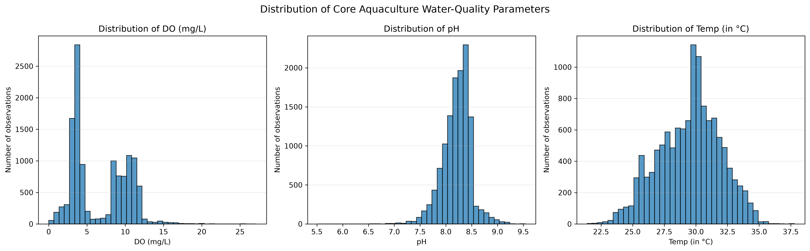
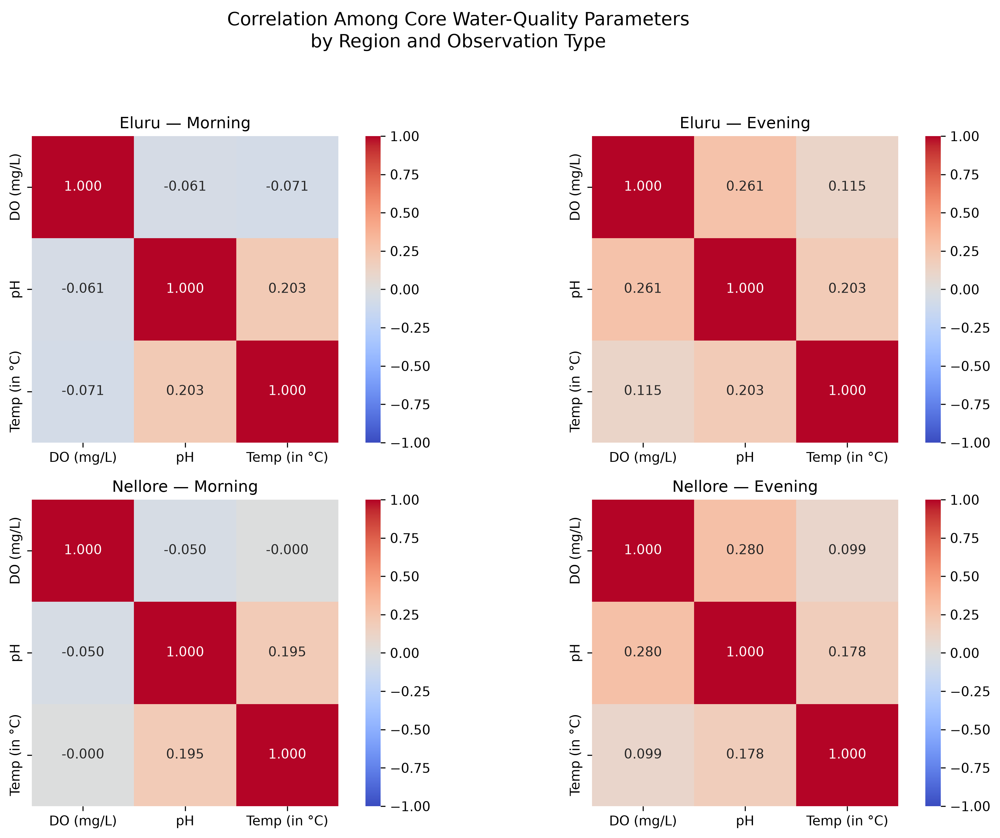
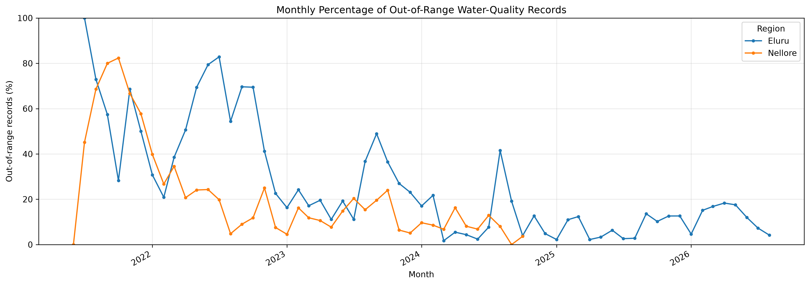
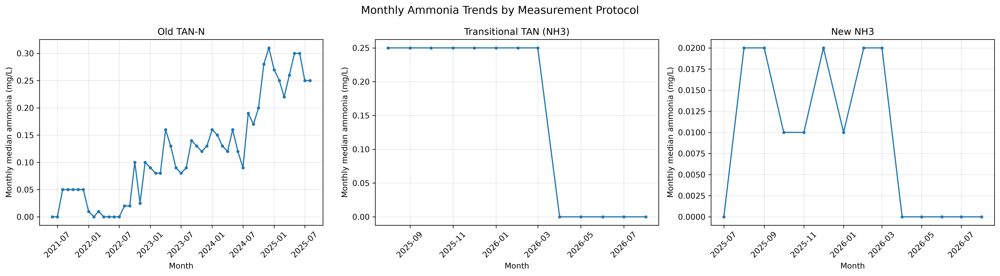

# AQUA — Statistical Analysis and Predictive Modelling of Aquaculture Water Quality

*A pond-level, region-aware study of whether routine water-quality measurements can help anticipate the status recorded at a pond's next visit.*

> **Project status:** Core data audit, exploratory analysis, predictive modelling and model error analysis completed. The results are retrospective research findings, not a validated real-time aquaculture alert system.
>
> **Repository:** [rohithg-codes/AQUA-DS-2026](https://github.com/rohithg-codes/AQUA-DS-2026)

---

## Why I started this project

AQUA grew out of a practical question connected to my grandfather's aquaculture experience: **can the water-quality measurements already collected at a pond help indicate whether its water quality may be recorded as out of range at the next visit?**

That question led me to a more careful set of questions before building a model. Are the measurements reliable? Are readings collected consistently? Do morning and evening observations mean the same thing? Are some fields missing because they were not collected, or because something went wrong? And, most importantly, what exactly does the dataset's recorded water-quality classification tell us?

Rather than jump straight to a prediction algorithm, I structured AQUA as a research workflow: audit the data, understand it, define a defensible prediction task, compare models, and investigate where their predictions fail.

The project uses publicly released aquaculture monitoring data from the Fish Welfare Initiative's Alliance for Responsible Aquaculture (ARA) programme in Andhra Pradesh, India. It does **not** use private farm records from my family.

## At a glance

| Item | Description |
|---|---|
| Project | AQUA |
| Research focus | Statistical analysis and next-observation water-quality classification |
| Domain | Aquaculture / water-quality monitoring |
| Data source | Fish Welfare Initiative (FWI), Farm Data — India |
| Regions represented in the analysed CSV | Eluru and Nellore, Andhra Pradesh, India |
| Raw dataset | 12,431 observations and 53 columns |
| Unique pond identifiers in the raw dataset | 317 |
| Eluru records | 9,248 |
| Nellore records | 3,183 |
| Recorded target labels | 10,064 `Yes`; 2,367 `No` |
| Recorded observation types | 6,454 Morning; 5,975 Evening; 2 unclassified |
| Raw observation date range | 19 June 2021 – 6 August 2026 |
| Primary predictors | pH, dissolved oxygen (DO), water temperature |
| Models compared | Logistic Regression and Random Forest, fitted separately by region |
| Main target | Recorded water-quality status at the next observation for the same pond |
| Main tools | Python, pandas, NumPy, Matplotlib, Seaborn, scikit-learn and joblib |

## Research question

**Using an earlier water-quality observation from a pond, can we predict whether that pond's next recorded water-quality observation will be classified as within range or out of range?**

This is deliberately a *next recorded observation* task. It is not a forecast for a fixed horizon such as the next 6, 12 or 24 hours. The time between consecutive visits varies considerably, and that variation is part of the study's limitations and interpretation.

### Target definition

The target is the source dataset's `Is WQ in range?` field at the **next chronological observation for the same pond**.

| Encoded class | Recorded label | Meaning in this analysis |
|---:|---|---|
| `0` | `Yes` | Water quality recorded as in range |
| `1` | `No` | Water quality recorded as out of range |

The positive class for precision, recall and F1-score is therefore **out of range (`1`)**.

This is a prediction of the dataset's recorded classification. It should not be read as an independent laboratory diagnosis, a direct measure of fish welfare, or proof that one universally unchanged biological threshold was applied throughout the full data period.

## Dataset and source attribution

The analysis uses `data/raw/water_quality.csv` from:

**Fish Welfare Initiative. (2026). _FWI Farm Data — India (June 2021 – August 2026)._**  
Source repository: <https://github.com/fish-welfare-initiative/fwi-farm-data-india>

The source repository includes a data dictionary and notes about changes in collection methods, measurement definitions, known data issues and the use of the dataset. The original source documentation is also preserved in this project under `docs/source_reference/`.

### Source retraction and data handling

FWI announced in October 2026 that Nellore water-quality measurements collected on or after **1 November 2024** had been retracted because at least one measurement had been fabricated and further affected readings were suspected. Those records were moved out of the main `water_quality.csv` file into a separate retracted-data file. FWI recommends excluding them from analysis. AQUA follows the updated source release and does not reintroduce that retracted Nellore water-quality file.

The Nellore historical test period in this study ends on 31 October 2024. The source also documents changes in dissolved-oxygen measurement methods (including a change in Eluru in March 2024 and in Nellore in November 2024) and changes to monitoring ranges over time. The retraction notice and the current source README should be consulted whenever this analysis is reproduced against a later data release:

- [FWI Farm Data — India: README and dataset notes](https://github.com/fish-welfare-initiative/fwi-farm-data-india/blob/main/README.md)
- [FWI: Data Issues and Retraction in Our Farm Program](https://www.fishwelfareinitiative.org/post/data-issues)
- [FWI data release information](https://www.fishwelfareinitiative.org/post/data-release-2026)

### Licence and attribution

The FWI dataset is released under **Creative Commons Attribution 4.0 International (CC BY 4.0)**. Reuse of the dataset requires appropriate credit to the source. The source data licence does not automatically determine the licence for the original AQUA notebooks, code or written analysis; no separate licence for those project materials is specified here.

The source provider describes the dataset as anonymised for farmer privacy. Refer to the provider's own documentation for the exact scope of anonymisation and the fields retained in the public release. FWI also notes that older 2021–2022 measurements may be less accurate than later measurements, and that measurement methods and acceptable ranges have changed over the programme period. These source-level caveats matter when interpreting historical patterns.

## Repository workflow

AQUA is organised as four sequential notebooks. Each notebook has a distinct job, and later stages use the findings and decisions documented in earlier stages.

| Notebook | Purpose | Main questions |
|---|---|---|
| `01_data_quality_audit.ipynb` | Data quality audit | What is in the dataset? What is missing, inconsistent, unusual or unsuitable for modelling? |
| `02_exploratory_data_analysis.ipynb` | Exploratory data analysis | How do measurements vary by region, observation type, time and recorded water-quality status? |
| `03_predictive_modelling.ipynb` | Predictive modelling | Can earlier measurements predict the next recorded status using chronological, pond-aware evaluation? |
| `04_model_interpretation_error_analysis.ipynb` | Model interpretation and error analysis | Where do models make false alerts or miss out-of-range observations, and how do errors vary across ponds and observation intervals? |

### 1. Data quality audit

The first notebook checks the raw data before modelling. It verifies dataset dimensions, pond identifiers, dates, duplicate records, measurement availability, categorical consistency, observation timing, pond-level monitoring frequency, target distribution, measurement protocols and potential target leakage.

The audit confirmed:

- 12,431 rows, 53 columns and 317 unique pond identifiers in the downloaded CSV.
- No duplicate full rows and no missing pond identifiers in the initial structural check.
- All collection dates were parseable using the date format present in the source file.
- Two records had no recorded morning/evening observation type.
- pH and DO each have 12,412 available values; temperature has 12,410. Each therefore has more than 99.8% availability in this file.
- Missingness is not automatically treated as a data-entry failure: some measurements are collected only under particular visit conditions.

The audit also identified several reasons not to use every available column as a model predictor:

- **Ammonia:** measurement definitions and protocols change over time. Old TAN-N, transitional TAN expressed as NH3 and newer NH3 measurements are kept distinct rather than treated as one directly comparable series. The audit documented an ammonia protocol transition in August 2025. Ammonia was excluded from the initial three-feature model.
- **TDS:** approximately 63.14% of values are missing in the analysed file, and unusually high values required source/unit verification. TDS was not included in the initial model.
- **Stocking density:** some records show substantial within-pond variation and repeated or unusually high values that need further verification before use as a stable predictor.
- **Equipment:** its high categorical cardinality makes it unsuitable for the initial, deliberately small predictor set without additional investigation.
- **`Parameters out of range`:** this field directly describes which parameter(s) were outside range and can reveal information about the target. It is treated as a leakage risk and excluded from predictors.

The raw dataset is preserved. Any derived data, exclusions and analysis outputs are saved separately.

### 2. Exploratory data analysis

The second notebook explores the distributions, temporal patterns, regional differences and relationships among the water-quality measurements. It examines repeated observations at pond level and treats correlations as descriptive associations rather than causal effects.

The three core measurements have very high coverage in the raw file (each exceeds 99.8% availability):

- pH
- Dissolved oxygen (DO)
- Water temperature

The EDA compares morning and evening observations, Eluru and Nellore, monthly recorded status, distributions by target class, and correlations among core measurements. It also examines ammonia separately by measurement protocol.

The analysis highlights why context matters. For example, the overall Pearson correlations among DO, pH and temperature do not tell the whole story: the relationship between DO and pH differs across region and observation type. Measurements are repeated within ponds, sampling frequencies are uneven, and acceptable DO ranges depend on measurement time. These patterns are useful for understanding the data, but they do not establish causation.

### 3. Predictive modelling

The third notebook formulates the problem as a chronological, pond-level next-observation prediction task.

For each pond, observations are ordered using the recorded date and time. The earlier measurement supplies the input features; the target is the recorded status at the next observation for that same pond. Transitions with ambiguous ordering caused by duplicated pond timestamps are excluded.

The modelling dataset contains:

- 12,114 consecutive observation pairs before ambiguous transitions are removed.
- 4 transitions involving duplicated timestamps are excluded, leaving 12,110 unambiguous pairs.
- 28 additional pairs are excluded because at least one of the three selected predictors is missing.
- **12,082 complete modelling pairs across 316 ponds** remain.
- Of these modelling pairs, 9,817 have a next status of `Yes` (in range) and 2,265 have a next status of `No` (out of range), or approximately 81.25% and 18.75%, respectively.

#### Predictors

The final matched model comparison uses the same three earlier-observation predictors in both algorithms:

1. `pH`
2. `DO (mg/L)`
3. `Temp (in °C)`

The reduced, consistently available predictor set was chosen after the data-quality and EDA stages. Leakage-prone fields and measurements with unresolved reliability or protocol issues were not included in this initial primary model.

#### Validation design

Random row-level splitting was avoided. The modelling workflow uses chronological training, validation and test periods, with split-boundary transitions excluded so that the target observation does not cross the temporal boundary.

- **Eluru:** the chronological training partition contains 9,665 pairs from 296 ponds. The primary test comparison uses 2,232 later observations from 118 ponds that also appear in the training period. A separate supplementary unseen-pond test contains 66 observations from 20 ponds, including only four out-of-range cases; it is too small to establish reliable generalisation to new ponds.
- **Nellore:** the historical temporal split uses 2,484 training pairs from 63 ponds and 573 later test pairs from 49 ponds. Boundary-crossing pairs are excluded. The Nellore evaluation is historical and ends before the source's 1 November 2024 retraction cutoff.

#### Algorithms and operating thresholds

The notebook includes earlier exploratory model/feature experiments. The **final matched regional comparison and exported four-model bundle** use the same three predictors in both algorithms, so their test metrics are comparable within each region. The exploratory time-aware feature trial is not the final matched model specification.

Two algorithms are compared in each region:

- **Logistic Regression:** a `StandardScaler` + `LogisticRegression` pipeline (`max_iter=1000`, `random_state=42`).
- **Random Forest:** 300 trees (`n_estimators=300`), `min_samples_leaf=5`, `class_weight="balanced_subsample"`, `random_state=42` and `n_jobs=-1`.

Operating thresholds are selected from regional validation data, then applied to the corresponding held-out test observations. The thresholds used in the final matched regional comparison are:

| Region | Model | Threshold |
|---|---|---:|
| Eluru | Logistic Regression | 0.20 |
| Eluru | Random Forest | 0.40 |
| Nellore | Logistic Regression | 0.40 |
| Nellore | Random Forest | 0.50 |

These are research operating points for the evaluated data, not universally calibrated probabilities or deployment-ready alert thresholds.

#### Final regional test results

The following table reports the final matched three-feature comparison. The positive class is `out of range` (`1`).

| Region | Model | Test observations | Test ponds | Threshold | Accuracy | Precision | Recall | F1-score | Balanced accuracy | Average precision | ROC-AUC |
|---|---|---:|---:|---:|---:|---:|---:|---:|---:|---:|---:|
| Eluru | Logistic Regression | 2,232 | 118 | 0.20 | 0.5591 | 0.1812 | **0.6122** | 0.2796 | 0.5814 | 0.3797 | 0.6501 |
| Eluru | Random Forest | 2,232 | 118 | 0.40 | **0.7760** | **0.3171** | 0.5224 | **0.3947** | **0.6698** | **0.4560** | **0.7456** |
| Nellore | Logistic Regression | 573 | 49 | 0.40 | **0.9354** | **0.6296** | 0.3864 | 0.4789 | 0.6837 | 0.4413 | 0.6313 |
| Nellore | Random Forest | 573 | 49 | 0.50 | 0.9232 | 0.5000 | **0.4773** | **0.4884** | **0.7188** | **0.4818** | **0.7731** |

The test sets have different class prevalences: Eluru contains 312 out-of-range cases among 2,232 primary test observations (13.98%); Nellore contains 44 among 573 (7.68%). Accuracy should therefore not be interpreted in isolation.

#### Model comparison and uncertainty

A paired pond-level bootstrap (2,000 resamples per region) compares Random Forest with Logistic Regression on the same regional test observations. Differences below are **Random Forest minus Logistic Regression**, in percentage points; a positive value favours Random Forest.

| Region | Metric | Difference (pp) | 95% CI (pp) | Interpretation |
|---|---|---:|---:|---|
| Eluru | Accuracy | +21.66 | [18.80, 24.58] | RF higher |
| Eluru | Precision | +13.37 | [9.42, 17.34] | RF higher |
| Eluru | Recall | −9.17 | [−16.48, −1.66] | LR higher |
| Eluru | F1-score | +11.27 | [7.13, 15.40] | RF higher |
| Eluru | Balanced accuracy | +8.74 | [4.89, 12.55] | RF higher |
| Eluru | Average precision | +7.41 | [2.69, 12.19] | RF higher |
| Eluru | ROC-AUC | +9.50 | [5.20, 13.95] | RF higher |
| Nellore | Accuracy | −1.25 | [−2.97, 0.39] | Difference uncertain |
| Nellore | Precision | −12.07 | [−28.57, 4.79] | Difference uncertain |
| Nellore | Recall | +9.88 | [−9.62, 27.50] | Difference uncertain |
| Nellore | F1-score | +2.06 | [−13.35, 19.04] | Difference uncertain |
| Nellore | Balanced accuracy | +3.90 | [−5.59, 12.51] | Difference uncertain |
| Nellore | Average precision | +4.64 | [−6.07, 15.58] | Difference uncertain |
| Nellore | ROC-AUC | +14.23 | [6.21, 23.94] | RF higher |

The Eluru comparison provides evidence favouring Random Forest on six metrics and Logistic Regression on recall. In Nellore, only the ROC-AUC difference has a 95% confidence interval that excludes zero. These results do **not** establish one universally superior algorithm.

### 4. Model interpretation and error analysis

The fourth notebook investigates false positives, false negatives and pond-level error patterns, then examines whether errors vary by measurement time and the interval between consecutive observations.

A key methodological finding is that the future measurement time and the elapsed time since the earlier measurement are strongly associated in the test data. The distributions have very limited overlap:

- In Eluru, only one morning target observation falls within the elapsed-time range shared with later-day observations.
- In Nellore, morning and later-day target observations have no overlapping elapsed-time range in the evaluated sample.

Consequently, a simple morning-versus-evening performance comparison cannot isolate the independent effect of time of day. The notebook also groups performance by short (≤24 hours), medium (>24 hours–7 days) and long (>7 days) observation intervals. Longer-interval groups show weak detection in several settings, but interval duration, measurement period and sample composition remain intertwined. These are descriptive findings, not proof that longer intervals cause model performance to deteriorate.

Pond-clustered bootstrap comparisons are used to respect repeated observations from the same pond. Small subgroups—especially Nellore medium-interval cases—are interpreted cautiously.

---

## Final model artifacts

Notebook 03 saves four fitted regional estimators (two algorithms for each region) in a single joblib bundle. The current preferred candidate operating configuration is Random Forest in each region, while Logistic Regression is retained as a benchmark:

| Region | Preferred candidate | Threshold | Benchmark |
|---|---|---:|---|
| Eluru | Random Forest | 0.40 | Logistic Regression (0.20) |
| Nellore | Random Forest | 0.50 | Logistic Regression (0.40) |

This is a **research selection**, not a claim of universal superiority or readiness for unsupervised farm decisions. The preferred model should be reconsidered if the relative cost of missed problems versus false alerts changes.

The exported artifacts are:

- `outputs/model_artifacts/regional_three_feature_models.joblib` — four fitted region/model combinations.
- `outputs/model_artifacts/model_manifest.json` — target, feature and threshold metadata.
- `outputs/model_artifacts/regional_test_predictions_for_error_analysis.csv` — test observations, outcomes, probabilities, thresholds and predictions.
- `outputs/model_artifacts/regional_test_predictions_with_target_timestamps.csv` — prediction records joined to the next-observation timestamp and elapsed interval.

Example: load the saved model bundle from a notebook launched with `notebooks/` as the working directory:

```python
import joblib

model_bundle = joblib.load(
    "../outputs/model_artifacts/regional_three_feature_models.joblib"
)

eluru_random_forest = model_bundle["Eluru"]["Random Forest"]
nellore_random_forest = model_bundle["Nellore"]["Random Forest"]
```

For prediction, provide a DataFrame with the same three columns used in training—`pH`, `DO (mg/L)` and `Temp (in °C)`—and apply the region's documented threshold to the class-1 probability. The class-1 probability is the model score for the recorded out-of-range class; it should not be assumed to be calibrated as a real-world risk probability.

## Selected research figures

The following figures are exported at high resolution in `outputs/figures/` and can be embedded in reports or presentations.

### Core water-quality distributions



### Regional and observation-type correlations



### Monthly water-quality status trends



### Ammonia measurement protocols



### Complete figure inventory

1. `01_monthly_ammonia_trends_by_protocol.png`
2. `02_ammonia_distributions_by_protocol_and_classification.png`
3. `03_water_colour_and_quality_status.png`
4. `04_regional_observation_type_correlation_heatmaps.png`
5. `05_temperature_distribution_by_target.png`
6. `06_ph_distribution_by_target_and_observation_type.png`
7. `07_dissolved_oxygen_distribution_by_target.png`
8. `08_monthly_water_quality_status_trends.png`
9. `09_regional_water_quality_distributions.png`
10. `10_morning_vs_evening_distribution_comparison.png`
11. `11_core_water_quality_distributions.png`

## Repository structure

```text
AQUA-DS-2026/
├── data/
│   └── raw/
│       └── water_quality.csv
├── docs/
│   └── source_reference/
│       ├── data_dictionary.md
│       └── official_README.md
├── notebooks/
│   ├── 01_data_quality_audit.ipynb
│   ├── 02_exploratory_data_analysis.ipynb
│   ├── 03_predictive_modelling.ipynb
│   └── 04_model_interpretation_error_analysis.ipynb
├── outputs/
│   ├── figures/
│   ├── model_artifacts/
│   └── tables/
├── .gitignore
└── README.md
```

### Key output tables

`outputs/tables/` contains the exported audit, monitoring and model-evaluation tables, including:

- `consolidated_data_quality_audit_findings.csv`
- `missing_values_report.csv`
- `ammonia_overlap_exceptions.csv`
- `pond_level_monitoring_intervals.csv`
- `corrected_pond_level_monitoring_intervals.csv`
- `regional_model_comparison.csv`
- `regional_bootstrap_comparison.csv`
- `final_modelling_consistency_audit.csv`
- `observation_interval_model_performance.csv`
- `observation_interval_bootstrap_comparison.csv`

## Reproducing the analysis

The notebooks were developed in Python 3.13.16. The project uses pandas, NumPy, Matplotlib, Seaborn, SciPy, statsmodels, scikit-learn, joblib and JupyterLab. This repository currently does not pin exact package versions in a dependency lockfile; results may vary slightly across library versions and environments.

### 1. Clone the repository

```bash
git clone https://github.com/rohithg-codes/AQUA-DS-2026.git
cd AQUA-DS-2026
```

### 2. Create and activate an environment

**Windows PowerShell:**

```powershell
python -m venv .venv
.\.venv\Scripts\Activate.ps1
python -m pip install --upgrade pip
pip install pandas numpy matplotlib seaborn scipy statsmodels scikit-learn joblib jupyterlab ipykernel
```

**macOS / Linux:**

```bash
python3 -m venv .venv
source .venv/bin/activate
python -m pip install --upgrade pip
pip install pandas numpy matplotlib seaborn scipy statsmodels scikit-learn joblib jupyterlab ipykernel
```

### 3. Launch Jupyter from the notebooks directory

```bash
cd notebooks
jupyter lab
```

Run the notebooks in this order:

1. `01_data_quality_audit.ipynb`
2. `02_exploratory_data_analysis.ipynb`
3. `03_predictive_modelling.ipynb`
4. `04_model_interpretation_error_analysis.ipynb`

The notebooks use relative paths to access `../data/` and `../outputs/`. Running them in the project structure shown above preserves those expected paths. Some outputs and model artifacts are generated by earlier notebooks and consumed by later ones.

## Limitations and responsible interpretation

AQUA is a retrospective study of a public observational dataset. It is not a deployed IoT system, a live monitoring service or a replacement for farm staff, laboratory measurements or expert judgement.

A few limitations matter throughout the project:

- **Next observation is not a fixed horizon.** The gap between visits ranges from minutes to many months. A prediction for the next recorded visit must not be described as a forecast for a fixed number of hours or days.
- **Repeated pond measurements are dependent.** Pond-aware splits and pond-level bootstrap procedures are used where appropriate, but the number of ponds and positive cases still limits some subgroup conclusions.
- **Target consistency changes over time.** The recorded `Is WQ in range?` label reflects the source programme's recorded classification. Measurement ranges and protocols have changed, so it should not be interpreted as one independently verified biological standard applied uniformly across the whole period.
- **Ammonia protocols are not interchangeable.** The different TAN/NH3 fields are kept separate; ammonia is not part of the initial three-feature model.
- **Retrospective evaluation is not prospective validation.** The reported test metrics do not guarantee performance on newly enrolled ponds, new regions or future operating conditions.
- **Thresholds encode trade-offs.** A lower threshold may detect more out-of-range observations but also generate more false alerts. The preferred threshold depends on how missed problems and false alerts would be handled in practice.
- **Associations are not causes.** Descriptive correlations and subgroup differences do not establish that a parameter or measurement time causes an out-of-range condition.

For these reasons, the models should be treated as research candidates requiring further prospective and independent validation before any farm-facing deployment or automated intervention.

## What comes next

The next research steps are to strengthen reproducibility, document the environment with pinned dependencies, prepare a full research report, and seek independent validation on additional pond observations. Potential future work includes calibration assessment, more explicit modelling of irregular observation intervals, evaluation on truly unseen ponds with adequate positive cases, and carefully justified additional predictors.

AQUA is a foundation to build on—not a claim that aquaculture water-quality prediction has been solved.

## Citation

If you use the source data, please credit:

> Fish Welfare Initiative. (2026). *FWI Farm Data — India (June 2021 – August 2026).* <https://github.com/fish-welfare-initiative/fwi-farm-data-india>

Please also consult the source repository's current README and data dictionary for updates, corrections, retractions and column definitions.

---

*Built as an applied data-science research project around a practical aquaculture question: how can existing pond-monitoring records be used more thoughtfully to understand and anticipate recorded water-quality problems?*
