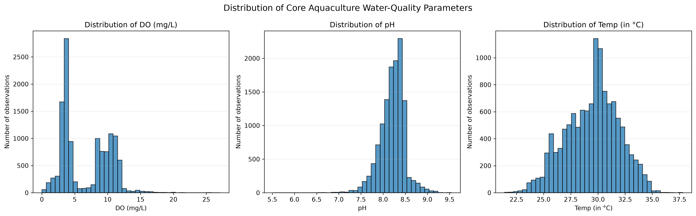
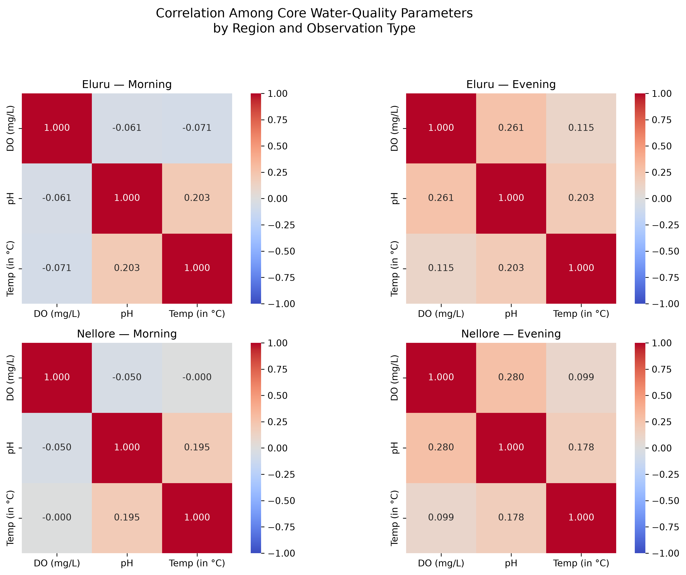
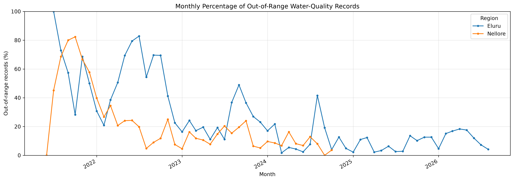
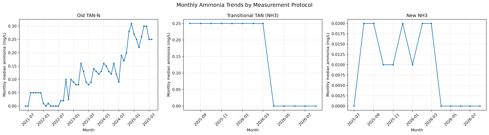

# AQUA — Statistical Analysis and Predictive Modelling of Aquaculture Water Quality

*A personal, research-led project exploring whether routine pond measurements can help anticipate the water-quality status recorded at a pond's next visit.*

> **Project status:** The four-notebook research workflow, retrospective model evaluation and model-interpretation analysis are complete. The models are research candidates, not a deployed monitoring system or a validated farm-level alert service.
>
> **Repository:** [rohithg-codes/AQUA-DS-2026](https://github.com/rohithg-codes/AQUA-DS-2026)

---

## Why I started AQUA

Water plays a central role in fish and prawn production. The condition of a pond is part of the environment in which the stock grows, and changes in dissolved oxygen, pH, temperature and other water-quality measurements can signal that something may need attention. Keeping track of those conditions is not always straightforward. Readings are taken at different times of day, not every parameter is measured on every visit, and the gap between two observations can range from a few hours to several weeks or even longer.

My interest in this problem came from seeing aquaculture challenges close to home through my grandfather's experience. Those practical difficulties made me curious about what the measurements already being collected could tell us: which conditions tend to appear alongside a recorded water-quality problem, how do those patterns differ between ponds and regions, and could an earlier reading help anticipate what may be recorded at the next visit?

I also have a genuine interest in coding and in using technology to work through problems that matter outside a computer screen. I wanted to bring that interest together with a field I had seen first-hand. Rather than begin by building an application or choosing an algorithm, I decided to start with the evidence. I first examined how the data had been collected, where it was incomplete or unusual, and what its measurements could reasonably support. I then explored the patterns and, only after that, tested predictive models.

That process became **AQUA**. It is my attempt to apply statistical analysis and machine learning to a practical aquaculture question, while being careful not to claim more than the data can show. The project uses the publicly released Fish Welfare Initiative dataset; it does **not** use private farm records from my family.

## Project at a glance

| Item | Description |
|---|---|
| Project | AQUA |
| Research focus | Statistical analysis and next-observation water-quality classification |
| Domain | Aquaculture / pond water-quality monitoring |
| Data source | Fish Welfare Initiative (FWI), Alliance for Responsible Aquaculture (ARA) programme, India |
| Regions in the analysed CSV | Eluru and Nellore, Andhra Pradesh, India |
| Raw dataset | 12,431 observations and 53 columns |
| Unique pond identifiers | 317 |
| Eluru observations | 9,248 |
| Nellore observations | 3,183 |
| Recorded target labels | 10,064 `Yes` (80.96%); 2,367 `No` (19.04%) |
| Recorded observation types | 6,454 Morning; 5,975 Evening; 2 unclassified |
| Raw observation date range | 19 June 2021 – 6 August 2026 |
| Primary model predictors | pH, dissolved oxygen (DO), water temperature |
| Algorithms compared | Logistic Regression and Random Forest, evaluated separately by region |
| Prediction target | Recorded water-quality status at the next observation for the same pond |
| Main tools | Python, pandas, NumPy, Matplotlib, Seaborn, SciPy, scikit-learn and joblib |

## The research question and prediction task

AQUA asks whether measurements from an earlier observation can help predict the status recorded at the **next chronological observation for the same pond**.

This is a next-visit prediction task, not a forecast for a fixed horizon such as the next 6, 12 or 24 hours. The next recorded visit may happen within hours, after several days, or much later. The elapsed time is therefore part of the problem and is examined explicitly in the modelling and error-analysis notebooks.

The target is the source field `Is WQ in range?` at the next observation:

| Encoded class | Source label | Meaning in AQUA |
|---:|---|---|
| `0` | `Yes` | Water quality recorded as in range |
| `1` | `No` | Water quality recorded as out of range |

The positive class for precision, recall and F1-score is **out of range (`1`)**. The models predict the dataset's recorded classification. They do not independently diagnose fish health, measure fish welfare, or establish that one unchanged biological threshold was applied throughout the complete study period.

## Dataset, source and responsible handling

The project uses `data/raw/water_quality.csv` from:

**Fish Welfare Initiative. (2026). _FWI Farm Data — India (June 2021 – August 2026)._**  
Source repository: <https://github.com/fish-welfare-initiative/fwi-farm-data-india>

The source repository provides the dataset, data dictionary, collection notes and known-issue documentation. Copies of the source README and data dictionary used during the audit are retained in `docs/source_reference/`.

### Nellore data retraction

In October 2026, FWI reported that at least one Nellore water-quality measurement had been fabricated and that other affected readings were suspected, although the organisation could not establish the full extent. FWI therefore retracted **all Nellore water-quality data collected on or after 1 November 2024**. The affected 1,136 records from 45 ponds were moved out of the main `water_quality.csv` file into a separate retracted-data file, and FWI recommends excluding them from analysis.

AQUA uses the updated main release and does not reintroduce that retracted Nellore file. The Nellore historical test period ends on 31 October 2024. The source notes that the cutoff coincides with Nellore's move to the Winkler method for dissolved-oxygen measurement. Eluru also changed its DO measurement method in March 2024. These changes, along with updates to monitoring ranges, mean that results from different regions and periods should not automatically be treated as directly comparable.

The source also cautions that older 2021–2022 measurements may be less accurate than later measurements, that some parameters were deliberately not collected for particular visit types, and that water-quality measures are imperfect proxies for fish welfare.

Useful source references:

- [FWI Farm Data — India: current README and dataset notes](https://github.com/fish-welfare-initiative/fwi-farm-data-india/blob/main/README.md)
- [FWI: Data Issues and Retraction in Our Farm Program](https://www.fishwelfareinitiative.org/post/data-issues)
- [FWI data release information](https://www.fishwelfareinitiative.org/post/data-release-2026)

### Licence and privacy

FWI releases the source dataset under **Creative Commons Attribution 4.0 International (CC BY 4.0)**. Reuse of the source data requires appropriate credit. That data licence does not automatically assign a licence to the AQUA notebooks, code or written analysis; no separate project-code licence is specified in this repository.

FWI describes the published pond IDs as randomly generated and says farmer names, GPS coordinates, village names and financial figures have been excluded. It also notes that staff names remain in some operational fields, including `Observer`, `Added by` and `Logged by`. The source's current privacy notes should be checked before reusing or combining the data with other material.

---

## Research workflow

AQUA is organised as four sequential notebooks. Each stage informs the next one.

| Notebook | Role | Main question |
|---|---|---|
| `01_data_quality_audit.ipynb` | Data quality audit | What is present in the dataset, what is missing or unusual, and which fields can be trusted for further analysis? |
| `02_exploratory_data_analysis.ipynb` | Exploratory data analysis | How do measurements and recorded status vary across regions, visit times, months and ponds? |
| `03_predictive_modelling.ipynb` | Predictive modelling | Can earlier measurements predict the status recorded at the next visit using chronological, pond-aware evaluation? |
| `04_model_interpretation_error_analysis.ipynb` | Model interpretation and error analysis | Where do the models make false alerts or miss out-of-range observations, and how do errors relate to ponds, timing and observation gaps? |

## 1. Data quality audit — understanding the evidence first

The first notebook examines the raw file before any modelling. It checks dataset structure, missingness, duplicate records, measurement availability, categories, collection dates and times, pond-level visit intervals, ammonia protocols, range consistency, unusual values, potential target leakage and predictor eligibility. The downloaded CSV is preserved rather than silently overwritten.

### Structural and recording checks

- The file contains **12,431 rows, 53 columns and 317 unique pond IDs**.
- The initial full-row duplicate check found **no exact duplicate rows**, and no pond IDs were missing.
- All 12,431 collection dates and all 12,431 recorded times were parsed successfully using the formats in the source file.
- Two records have no Morning/Evening value in the `Type` field.
- Four rows form two repeated pond-date-time groups: the same pond and timestamp appear with different Morning/Evening labels. There are no repeated combinations after `Type` is included, but the repeated timestamps create ambiguous chronological transitions. The modelling stage excludes transitions touching duplicated pond timestamps rather than arbitrarily choosing an order.
- Seventeen records were recorded at `00:00`, and a small number of other unusual clock times were investigated rather than silently recoded.
- Monitoring frequency differs across ponds and regions, so repeated observations are not independent and gaps between visits are not uniform.

### Measurement availability and reliability

The three measurements carried into the primary model have very high availability:

| Measurement | Available values | Missing values | Availability |
|---|---:|---:|---:|
| pH | 12,412 | 19 | 99.85% |
| DO (mg/L) | 12,412 | 19 | 99.85% |
| Temperature (°C) | 12,410 | 21 | 99.83% |

Other fields need more care:

| Field | Available values | Missing values | Missingness / issue |
|---|---:|---:|---|
| Turbidity | 4,898 | 7,533 | 60.60% missing; collected conditionally |
| TDS | 4,582 | 7,849 | 63.14% missing; maximum recorded value 936.00 and 242 IQR outlier flags |
| Old TAN-N ammonia | 5,292 | 7,139 | 57.43% missing; historical protocol |
| Transitional TAN (NH3) | 1,659 | 10,772 | 86.65% missing; transitional protocol |
| New NH3 | 1,660 | 10,771 | 86.65% missing; newer protocol |
| Feed amount | 6,756 | 5,675 | 45.65% missing; prediction-time availability needs checking |
| Species | 8,650 | 3,781 | 30.42% missing; recording consistency needs checking |
| Weather | 11,703 | 728 | 5.86% missing; multiple combined categories |
| Water colour | 11,572 | 859 | 6.91% missing |
| Equipment | 11,945 | 486 | 183 recorded categories; high cardinality |
| Observer | 9,501 | 2,930 | 12 recorded categories; possible observer-related variation |
| Stocking density | 9,780 | 2,651 | 21.33% missing; unusually high and repeated values |

Alkalinity and hardness have no populated values in this file; the source documentation indicates that these parameters were not collected. Such structural absence is different from an ordinary missing measurement.

TDS deserves particular caution. Its median is 1.18, its maximum is 936.00, and 242 observations were flagged by the IQR rule. The extreme values were inspected against dates, ponds, observers and equipment, but their units and reliability were not conclusively resolved. IQR flags are statistical warnings, not proof that a reading is wrong.

Stocking density has 1,411 IQR outlier flags among 9,780 available records. Values at or above 100,000 per acre recur across eight ponds, with a maximum of 235,294 per acre. The repeated pond-level patterns require source verification; these records were not automatically deleted or treated as confirmed errors.

### Range checks and target consistency

The audit compared recorded measurements with documented checks while recognising that monitoring criteria and ranges can change over time.

- **Dissolved oxygen:** 1,584 observations were outside the audit's Type-specific expected range: 937 Morning and 647 Evening. Of these, **35 were still labelled `Yes`** in `Is WQ in range?`; 1,549 were labelled `No`.
- **pH:** 797 observations were outside the documented 6.5–8.5 range, and all 797 were labelled `No`.

These are range-versus-label consistency checks, not a declaration that every record is wrong. The recorded target is retained for modelling, but the checks show why it should not be treated as an independently verified biological standard applied unchanged to every observation.

### Ammonia protocol and threshold checks

The file contains three ammonia fields with different periods and definitions. They are kept separate:

| Ammonia field | Available records | Recorded date coverage |
|---|---:|---|
| Old TAN-N: `Ammonia—TAN (NH3-N) (mg/L)` | 5,292 | 19 Jun 2021 – 19 Aug 2025 |
| Transitional TAN (NH3): `Ammonia—TAN (NH3) (mg/L)` | 1,659 | 1 Aug 2025 – 6 Aug 2026 |
| New NH3: `Ammonia—NH3 (mg/L)` | 1,660 | 31 Jul 2025 – 6 Aug 2026 |

The protocol fields overlap only in a very small number of records; they are not one interchangeable continuous series. The old TAN-N field had 5,290 records where it was the only ammonia measurement populated. The transitional TAN and new NH3 fields were both populated in 1,658 records. A few exceptional records contained other combinations, which were inspected separately.

The audit also checked documented thresholds where available:

- For old TAN-N, the documented 0.50 mg/L threshold was reached or exceeded in 168 of 1,154 records labelled out of range (14.56%); none of the 4,138 records labelled in range reached that threshold.
- For new NH3, the documented 0.05 mg/L threshold was reached or exceeded in 73 of 245 out-of-range records (29.80%) and 8 of 1,415 in-range records (0.57%). All eight in-range exceptions were exactly at 0.05 mg/L. There were 19 records exactly at the boundary: 11 labelled out of range and 8 labelled in range.
- The transitional TAN (NH3) field did not have a documented threshold used in this audit, so it was not assigned an assumed one.

For 393 paired records with the required transitional TAN, new NH3, pH and temperature values, the theoretical unionised-NH3 calculation correlated with recorded NH3 (Pearson r = 0.9942; Spearman r = 0.9864; mean absolute difference = 0.00146 mg/L). After rounding the theoretical value to two decimals, 384 of 393 records (97.71%) matched the recorded value. This is a **formula-consistency check**, not independent laboratory validation, and it does not make the different historical ammonia fields interchangeable. Ammonia was excluded from the primary three-feature model.

### Target leakage and post-outcome fields

The field `Parameters out of range` directly describes which parameter(s) were outside range and is therefore a target-leakage risk. It was excluded from predictors. The audit also found **57 records** where `Have fish been helped` was `Yes`; all 57 were labelled as water quality in range. Fields such as `Have fish been helped`, `Water quality improved after corrective actions` and follow-up/intervention variables can describe actions taken after a problem was identified. They were excluded from baseline prediction features because they may contain post-outcome information.

The final predictor review retained pH, DO and temperature as the initial primary model features. Observation type, date/time and region were considered as contextual or conditional variables; turbidity, TDS, ammonia, stocking density, feed, species, weather, water colour, equipment, observer, pond status and group were reviewed but not automatically included. Availability, reliability, confounding and whether a value is genuinely known at prediction time all matter.

---

## 2. Exploratory data analysis — patterns that stood out

The second notebook explores the three core measurements, Morning/Evening differences, regional coverage, monthly recorded status, water-colour and weather categories, ammonia protocols and parameter correlations. These findings are descriptive; they are not causal claims.

### Core measurements and observation type

Across all observations, the descriptive statistics for the three primary measurements were:

| Measurement | Mean | Median | Standard deviation | Minimum | Maximum |
|---|---:|---:|---:|---:|---:|
| DO (mg/L) | 6.636 | 4.70 | 3.622 | 0.00 | 27.10 |
| pH | 8.216 | 8.25 | 0.276 | 5.52 | 9.54 |
| Temperature (°C) | 29.503 | 29.80 | 2.441 | 21.40 | 37.80 |

Morning and Evening readings have noticeably different distributions:

| Measurement | Morning median | Evening median |
|---|---:|---:|
| DO (mg/L) | 3.5 | 10.2 |
| pH | 8.11 | 8.38 |
| Temperature (°C) | 28.8 | 30.8 |

The regional summaries show further variation:

| Region | Morning DO median | Evening DO median | Morning pH median | Evening pH median | Morning temperature median | Evening temperature median |
|---|---:|---:|---:|---:|---:|---:|
| Eluru | 3.4 | 10.5 | 8.15 | 8.40 | 28.4°C | 30.5°C |
| Nellore | 3.7 | 9.3 | 8.03 | 8.30 | 29.6°C | 31.4°C |

This is why pooled DO distributions need context. A single overall median can hide the strong distinction between Morning and Evening measurement conditions.

### Recorded water-quality status and monthly coverage

Across the raw file, 80.96% of observations were recorded as `Yes` and 19.04% as `No`. The out-of-range proportion varied by region and observation type:

| Region | Observation type | Out-of-range (`No`) |
|---|---|---:|
| Eluru | Morning | 20.12% |
| Eluru | Evening | 16.44% |
| Nellore | Morning | 19.39% |
| Nellore | Evening | 22.52% |

Monthly coverage is uneven. Eluru spans July 2021–August 2026 (62 months; median monthly count 121), while Nellore spans June 2021–October 2024 (41 months; median monthly count 72). Some early months have very small samples: 12 Eluru observations in July 2021 and two Nellore observations in June 2021. Percentages from such months should be read cautiously.

### Recorded status by core measurement

The distributions also differ when observations are grouped by the source's in-range/out-of-range label:

| Measurement / visit type | In-range median | Out-of-range median |
|---|---:|---:|
| DO — Morning | 3.5 mg/L | 2.4 mg/L |
| DO — Evening | 10.3 mg/L | 9.4 mg/L |
| pH — Morning | 8.10 | 8.18 |
| pH — Evening | 8.37 | 8.51 |
| Temperature — Morning | 28.7°C | 29.0°C |
| Temperature — Evening | 30.7°C | 31.1°C |

These are distributions within the recorded classification, not evidence that any one parameter alone determines the label. The source's criteria and monitoring practices can change over time.

### Relationships among the core measurements

The overall Pearson correlations were:

| Pair | Pearson r |
|---|---:|
| DO and pH | +0.490 |
| DO and temperature | +0.416 |
| pH and temperature | +0.331 |

The pooled DO–pH relationship changes by observation type: it is −0.083 in Morning observations and +0.294 in Evening observations. Within regions, the DO–pH correlations are −0.061 for Eluru Morning and +0.261 for Eluru Evening; in Nellore they are −0.050 for Morning and +0.280 for Evening. This is one reason AQUA keeps region and observation type visible rather than relying only on pooled correlations. Correlation does not establish causation.

### Water colour and weather patterns

The recorded out-of-range proportion varied across water-colour categories:

| Water colour | Records | Out-of-range (`No`) |
|---|---:|---:|
| Dark brown | 62 | 37.10% |
| Light brown | 895 | 23.46% |
| Light green | 3,086 | 21.68% |
| Dark green | 5,517 | 14.74% |
| Saturated green | 1,672 | 14.89% |
| Transparent | 340 | 11.47% |

Dark brown had the highest recorded out-of-range proportion, but its group contains only 62 records. Its percentage is therefore more sensitive to a small number of observations than the larger colour groups.

Water colour was missing in 859 records (6.91%). Within region/visit-type groups, the recorded out-of-range percentage was higher when colour was missing (about 39–46%) than when it was recorded (about 15–19%). Weather was missing in 728 records (5.86%); the out-of-range proportion in missing-weather groups ranged from about 48% to 70%, compared with about 14–16% where weather was recorded in the corresponding groups. These differences may reflect collection workflow, visit context or other factors. They do not show that missing colour or weather causes poor water quality, and missingness was not treated as a causal predictor.

### Ammonia patterns in the EDA

The EDA kept the three ammonia columns separate and examined their availability, target distributions and threshold behaviour. Of 12,431 records, 5,481 had no ammonia measurement; 5,290 had only old TAN-N; 1,658 had both transitional TAN and new NH3; only a very small number had other protocol combinations.

For new NH3, 73 of 245 out-of-range records were at or above the 0.05 mg/L threshold, compared with 8 of 1,415 in-range records. The eight in-range records were exactly at 0.05 mg/L, the threshold boundary. The EDA inspected these cases individually rather than automatically changing their labels. The old TAN-N threshold check and the theoretical NH3 consistency exercise are described in the data-quality audit above.

---

## 3. Predictive modelling — what was tested

### Building the prediction pairs

Observations were sorted chronologically within each pond using the recorded date and time. Each modelling row uses an earlier observation as input and the next recorded observation for that pond as the target.

The chronology audit identified 12,114 consecutive transitions. Four transitions touching two duplicated pond-timestamp groups had ambiguous order and were excluded. This left 12,110 unambiguous transitions. A further 28 pairs were excluded because at least one of the three selected predictors was missing. The final complete modelling set contained **12,082 pairs across 316 ponds**:

- 9,817 next observations recorded as `Yes` (in range; 81.25%).
- 2,265 next observations recorded as `No` (out of range; 18.75%).

The median gap between consecutive observations was 1.56 days; the mean was 13.28 days, the 90th percentile was 32.99 days and the maximum was 1,097.55 days (about three years). Only 4,552 pairs were within 30 days. The long right tail matters: a model output is for the next recorded visit, which may be much later than the input measurement.

### Predictors and model configurations

The final matched model comparison uses the same three earlier-observation predictors in both algorithms:

1. `pH`
2. `DO (mg/L)`
3. `Temp (in °C)`

Logistic Regression is implemented as a `StandardScaler` + `LogisticRegression` pipeline (`max_iter=1000`, `random_state=42`). Random Forest uses 300 trees (`n_estimators=300`), `min_samples_leaf=5`, `class_weight="balanced_subsample"`, `random_state=42` and `n_jobs=-1`.

There were earlier exploratory experiments with time-aware features and feature ablation. In one validation ablation, pH + DO had average precision 0.2378 and ROC-AUC 0.6645; adding temperature gave 0.2607 and 0.6922; an earlier five-feature configuration gave 0.2559 and 0.6936. Those are exploratory validation results, not the final regional test metrics. The final matched comparison retains the three consistently available core measurements so both algorithms are assessed using the same predictors and partitions.

### Validation and test design

Random row-level splitting was avoided. The modelling workflow preserves chronological order within ponds, uses validation data to select thresholds, and excludes transitions that cross split boundaries. Pond identifiers are retained for grouping and bootstrap resampling, not used as ordinary model features.

- **Eluru primary temporal test:** 2,232 later observations from 118 ponds that also appear in the training period. This evaluates later observations for previously monitored ponds.
- **Eluru supplementary unseen-pond check:** 66 observations from 20 ponds, with only four out-of-range cases. This is too small to establish reliable generalisation to unseen ponds. In the three-feature Random Forest check, two of the four out-of-range cases were detected, with six false alerts; these results are descriptive only.
- **Nellore historical test:** 573 observations from 49 ponds, including 44 out-of-range cases. Nellore was evaluated separately using historical data ending before the 1 November 2024 retraction cutoff. Its validation/test pathway and period are not identical to Eluru's later-period test.

Thresholds were selected from the corresponding regional validation data rather than tuned on the test results.

### Final regional test results

The table below is the final matched three-feature comparison. `No` / out of range is the positive class. The confusion counts are reported as TP / FP / FN / TN. Alert rate is the proportion of test observations classified as out of range.

| Region | Model | Test n | Test ponds | Threshold | TP / FP / FN / TN | Accuracy | Precision | Recall | F1 | Balanced accuracy | Average precision | ROC-AUC | Alert rate |
|---|---|---:|---:|---:|---|---:|---:|---:|---:|---:|---:|---:|---:|
| Eluru | Logistic Regression | 2,232 | 118 | 0.20 | 191 / 863 / 121 / 1,057 | 0.5591 | 0.1812 | **0.6122** | 0.2796 | 0.5814 | 0.3797 | 0.6501 | 47.22% |
| Eluru | Random Forest | 2,232 | 118 | 0.40 | 163 / 351 / 149 / 1,569 | **0.7760** | **0.3171** | 0.5224 | **0.3947** | **0.6698** | **0.4560** | **0.7456** | 23.03% |
| Nellore | Logistic Regression | 573 | 49 | 0.40 | 17 / 10 / 27 / 519 | **0.9354** | **0.6296** | 0.3864 | 0.4789 | 0.6837 | 0.4413 | 0.6313 | 4.71% |
| Nellore | Random Forest | 573 | 49 | 0.50 | 21 / 21 / 23 / 508 | 0.9232 | 0.5000 | **0.4773** | **0.4884** | **0.7188** | **0.4818** | **0.7731** | 7.33% |

Accuracy alone would give a misleading impression on this imbalanced target. In an earlier baseline comparison, a majority-class classifier reached 86.02% accuracy while detecting none of the out-of-range cases (zero recall). That is why AQUA reports precision, recall, F1, balanced accuracy, average precision and ROC-AUC alongside accuracy.

### Paired pond-level bootstrap comparison

Random Forest minus Logistic Regression differences were evaluated with 2,000 paired pond-level bootstrap resamples per region. Positive values favour Random Forest; negative values favour Logistic Regression. Confidence intervals are in percentage points.

| Region | Metric | Difference (RF − LR), pp | 95% CI, pp |
|---|---|---:|---:|
| Eluru | Accuracy | +21.66 | [18.80, 24.58] |
| Eluru | Precision | +13.37 | [9.42, 17.34] |
| Eluru | Recall | −9.17 | [−16.48, −1.66] |
| Eluru | F1 | +11.27 | [7.13, 15.40] |
| Eluru | Balanced accuracy | +8.74 | [4.89, 12.55] |
| Eluru | Average precision | +7.41 | [2.69, 12.19] |
| Eluru | ROC-AUC | +9.50 | [5.20, 13.95] |
| Nellore | Accuracy | −1.25 | [−2.97, 0.39] |
| Nellore | Precision | −12.07 | [−28.57, 4.79] |
| Nellore | Recall | +9.88 | [−9.62, 27.50] |
| Nellore | F1 | +2.06 | [−13.35, 19.04] |
| Nellore | Balanced accuracy | +3.90 | [−5.59, 12.51] |
| Nellore | Average precision | +4.64 | [−6.07, 15.58] |
| Nellore | ROC-AUC | +14.23 | [6.21, 23.94] |

In Eluru, the paired intervals exclude zero for all seven metrics: six favour Random Forest and recall favours Logistic Regression. In Nellore, only the ROC-AUC difference has an interval entirely above zero. The other six differences remain uncertain on this test sample. These intervals are conditional on the fitted models, chosen thresholds and available test observations; they do not include all uncertainty from retraining or future data collection.

### Model selection — a qualified choice

For the current research artifact, Random Forest is retained as the **preferred candidate** in both regions, with Logistic Regression kept as a benchmark:

| Region | Preferred candidate | Threshold used | Benchmark |
|---|---|---:|---|
| Eluru | Random Forest | 0.40 | Logistic Regression (0.20) |
| Nellore | Random Forest | 0.50 | Logistic Regression (0.40) |

This is a practical research choice based on the combined ranking and balanced metrics, not proof that Random Forest is universally superior. In Eluru, Logistic Regression has higher recall at its selected threshold. In Nellore, most paired metric differences are uncertain, although Random Forest has higher ROC-AUC. The appropriate operating point would depend on the practical cost of missed problems versus false alerts; that cost has not been established with farm operators in this study.

---

## 4. Model interpretation and error analysis

The fourth notebook looks beyond one overall score. It investigates false positives, false negatives, the distribution of errors across ponds, measured conditions associated with missed cases, prediction-score margins, input and target measurement times, and elapsed intervals between visits.

### Errors are spread across ponds

The errors are not concentrated in one or two ponds. In the Eluru primary test:

| Model | False negatives | Ponds with at least one FN | False positives | Ponds with at least one FP |
|---|---:|---:|---:|---:|
| Logistic Regression | 121 | 57 | 863 | 116 |
| Random Forest | 149 | 67 | 351 | 103 |

In Nellore, Logistic Regression produced 27 false negatives across 17 ponds and 10 false positives across 8 ponds. Random Forest produced 23 false negatives across 16 ponds and 21 false positives across 18 ponds. Pond-level error rates were also examined; median per-pond false-negative rates were around 50% in all four region/model combinations, while false-positive-rate distributions differed substantially between models and regions.

This is why the analysis does not treat all rows as independent or rely only on a single pooled confusion matrix.

### Input measurement time and future target time are different

When test records are grouped by the **earlier input measurement time**, recall was higher for Morning inputs in each region/model combination:

| Region | Model | Morning-input recall | Later-day-input recall |
|---|---|---:|---:|
| Eluru | Logistic Regression | 89.81% | 32.26% |
| Eluru | Random Forest | 64.97% | 39.35% |
| Nellore | Logistic Regression | 63.64% | 13.64% |
| Nellore | Random Forest | 95.45% | 0.00% |

The prediction export was then joined to the actual `Next observation timestamp`. When records were grouped by the **future target measurement time**, the pattern reversed:

| Region | Model | Future Morning recall | Future later-day recall |
|---|---|---:|---:|
| Eluru | Logistic Regression | 34.55% | 91.16% |
| Eluru | Random Forest | 37.58% | 68.71% |
| Nellore | Logistic Regression | 13.64% | 63.64% |
| Nellore | Random Forest | 0.00% | 95.45% |

These are not contradictory calculations: they group records by different timestamps. They also reveal a design limitation. Future later-day observations were almost entirely short-gap observations, while future Morning observations were mostly medium- or long-gap observations. There was too little shared elapsed-time support to isolate time of day:

- In Eluru, the common interval range was 2.17–10.18 hours, but only **one** Morning target observation fell in it, compared with 1,113 later-day observations.
- In Nellore, the Morning and later-day interval ranges did **not overlap**.

Therefore, AQUA does not claim that morning or evening conditions independently make the future target easier or harder to predict. Within-pond paired analyses and pond-level bootstrap checks also examined the time-of-day pattern, but they do not remove the lack of interval overlap.

A paired analysis restricted to ponds with out-of-range target observations in both input-time groups pointed in the same descriptive direction. Among 51 paired Eluru ponds, later-day-input recall was lower than morning-input recall in 43 ponds for Logistic Regression (8 were unchanged) and in 36 ponds for Random Forest (10 were higher and 5 unchanged). Among 14 paired Nellore ponds, later-day-input recall was lower in 8 ponds for Logistic Regression (6 unchanged) and 13 ponds for Random Forest (1 unchanged). Pond-level bootstrap estimates for the later-day-minus-morning recall difference were −63.05 percentage points for Eluru Logistic Regression (95% CI [−73.51, −52.03]), −36.80 for Eluru Random Forest ([−51.34, −21.72]), −48.21 for Nellore Logistic Regression ([−71.43, −25.00]) and −92.86 for Nellore Random Forest ([−100.00, −78.57]). These are paired descriptive results on restricted subsets—especially small in Nellore—and remain subject to the same measurement-time/interval confounding.

The median core measurements also differed between detected and missed out-of-range observations. Across both regions and both algorithms, the median DO among detected cases was around 3.2–3.4 mg/L, while the median DO among missed cases was around 8.7–11.1 mg/L. Missed cases also tended to have slightly lower median pH in these comparisons. This pattern is consistent with the time-of-day differences in the recorded DO distributions, but it is not proof that high DO caused the errors or that the models learned a biological mechanism.

### Performance by elapsed observation interval

The interval analysis grouped records into short (≤24 hours), medium (>24 hours to 7 days) and long (>7 days) gaps. The table reports selected-threshold performance. The group composition is important: Eluru's short interval group contains both Morning and later-day target observations; its medium and long groups are almost entirely Morning. Nellore's short group is later-day, while its medium and long groups are Morning.

| Region | Interval | Test n | Ponds | Out-of-range cases | Median gap | LR recall / F1 / balanced accuracy | RF recall / F1 / balanced accuracy |
|---|---|---:|---:|---:|---:|---|---|
| Eluru | Short | 1,172 | 118 | 168 | 8.75 h | 88.10% / 0.3119 / 62.52% | 68.45% / 0.5707 / 78.25% |
| Eluru | Medium | 130 | 69 | 43 | 40.17 h | 46.51% / 0.3636 / 46.24% | 53.49% / 0.3680 / 42.84% |
| Eluru | Long | 930 | 112 | 101 | 494.43 h | 22.77% / 0.1498 / 50.35% | 24.75% / 0.1678 / 52.00% |
| Nellore | Short | 309 | 49 | 22 | 10.00 h | 63.64% / 0.6222 / 80.25% | 95.45% / 0.7000 / 94.77% |
| Nellore | Medium | 29 | 21 | 3 | 39.17 h | 66.67% / 0.8000 / 83.33% | 0.00% / 0.0000 / 42.31% |
| Nellore | Long | 235 | 46 | 19 | 710.30 h | 5.26% / 0.0952 / 52.40% | 0.00% / 0.0000 / 50.00% |

The medium Nellore group contains only three out-of-range cases, so its percentages are highly sensitive to individual observations. The long-gap results are concerning, but interval length, observation time, region and sample composition are intertwined. They do not show that long gaps alone cause lower predictive performance.

A further paired pond-level bootstrap (2,000 resamples) compared Random Forest with Logistic Regression within each interval group. In Eluru's short group, Random Forest had higher F1 (+25.88 percentage points; 95% CI [18.92, 32.05]) and balanced accuracy (+15.73; [9.96, 20.68]), while Logistic Regression had higher recall (RF − LR: −19.64; [−29.89, −11.18]). In Nellore's short group, Random Forest had higher recall (+31.82; [13.33, 53.85]) and balanced accuracy (+14.52; [5.07, 25.46]); its F1 difference (+7.78; [−7.10, 24.75]) remained uncertain. Most Eluru medium/long differences were uncertain. Nellore medium/long estimates are exploratory because the positive-case counts are small; some bootstrap intervals reach zero at a boundary because many resamples contain no detected positives.

---

## Final model artifacts

Notebook 03 exports four fitted estimators—Logistic Regression and Random Forest for each region—in one joblib bundle:

- `outputs/model_artifacts/regional_three_feature_models.joblib` — the four fitted estimators.
- `outputs/model_artifacts/model_manifest.json` — target encoding, predictors, region-specific thresholds and export metadata.
- `outputs/model_artifacts/regional_test_predictions_for_error_analysis.csv` — 2,805 regional test prediction records, including actual outcomes, model scores, thresholds and predicted classes.
- `outputs/model_artifacts/regional_test_predictions_with_target_timestamps.csv` — the same 2,805 records joined to next-observation timestamps and elapsed intervals; all 2,805 records were matched, with zero unmatched records.

The median elapsed intervals in the exported evaluation set were 13.92 hours for Eluru and 10.45 hours for Nellore. The maxima were 5,751.50 and 6,734.75 hours, respectively. This reinforces that the target is next-visit status, not a fixed-horizon forecast.

Example: load the saved bundle from a notebook launched with `notebooks/` as the working directory:

```python
import joblib

model_bundle = joblib.load(
    "../outputs/model_artifacts/regional_three_feature_models.joblib"
)

eluru_random_forest = model_bundle["Eluru"]["Random Forest"]
nellore_random_forest = model_bundle["Nellore"]["Random Forest"]
```

For predictions, provide the three training feature columns—`pH`, `DO (mg/L)` and `Temp (in °C)`—and use the threshold for the appropriate region. The class-1 score is a model output for the recorded out-of-range class; probability calibration as a real-world risk estimate has not been established.

## Research figures

Eleven figures are intended to be exported at 300 dpi in `outputs/figures/`. They document the principal EDA findings:

1. `01_monthly_ammonia_trends_by_protocol.png`
2. `02_ammonia_distributions_by_protocol_and_classification.png`
3. `03_water_colour_and_quality_status.png`
4. `04_regional_observation_type_correlation_heatmaps.png`
5. `05_temperature_distribution_by_target.png`
6. `06_ph_distribution_by_target_and_observation_type.png`
7. `07_dissolved_oxygen_distribution_by_target.png`
8. `08_monthly_water_quality_status_trends.png`
9. `09_regional_water_quality_distributions.png`
10. `10_morning_vs_evening_distribution_comparison.png`
11. `11_core_water_quality_distributions.png`

Selected figures are embedded below. The plots are descriptive and should be read with the sample-size, missingness and measurement-protocol context described above.

### Core water-quality distributions



### Regional and observation-type correlations



### Monthly water-quality status trends



### Ammonia measurement protocols



## Repository structure

```text
AQUA-DS-2026/
├── data/
│   └── raw/
│       └── water_quality.csv
├── docs/
│   └── source_reference/
│       ├── data_dictionary.md
│       └── official_README.md
├── notebooks/
│   ├── 01_data_quality_audit.ipynb
│   ├── 02_exploratory_data_analysis.ipynb
│   ├── 03_predictive_modelling.ipynb
│   └── 04_model_interpretation_error_analysis.ipynb
├── outputs/
│   ├── figures/
│   ├── model_artifacts/
│   └── tables/
├── .gitignore
└── README.md
```

### Key exported tables

`outputs/tables/` includes:

- `consolidated_data_quality_audit_findings.csv`
- `missing_values_report.csv`
- `ammonia_overlap_exceptions.csv`
- `pond_level_monitoring_intervals.csv`
- `corrected_pond_level_monitoring_intervals.csv`
- `regional_model_comparison.csv`
- `regional_bootstrap_comparison.csv`
- `final_modelling_consistency_audit.csv`
- `observation_interval_model_performance.csv`
- `observation_interval_bootstrap_comparison.csv`

## Reproducing the analysis

The notebooks were developed in Python 3.13.16. The analysis uses pandas, NumPy, Matplotlib, Seaborn, SciPy, scikit-learn, statsmodels, joblib and JupyterLab. Package versions are not yet pinned in a lockfile; a `requirements.txt` or environment file should be added before claiming bit-for-bit reproducibility in a fresh environment.

### 1. Clone the repository

```bash
git clone https://github.com/rohithg-codes/AQUA-DS-2026.git
cd AQUA-DS-2026
```

### 2. Create and activate an environment

**Windows PowerShell:**

```powershell
python -m venv .venv
.\.venv\Scripts\Activate.ps1
python -m pip install --upgrade pip
pip install pandas numpy matplotlib seaborn scipy scikit-learn statsmodels joblib jupyterlab ipykernel
```

**macOS / Linux:**

```bash
python3 -m venv .venv
source .venv/bin/activate
python -m pip install --upgrade pip
pip install pandas numpy matplotlib seaborn scipy scikit-learn statsmodels joblib jupyterlab ipykernel
```

### 3. Launch Jupyter from the notebooks directory

```bash
cd notebooks
jupyter lab
```

Run the notebooks in this order:

1. `01_data_quality_audit.ipynb`
2. `02_exploratory_data_analysis.ipynb`
3. `03_predictive_modelling.ipynb`
4. `04_model_interpretation_error_analysis.ipynb`

The notebooks use relative paths to read from `../data/` and write to `../outputs/`. Launching Jupyter from `notebooks/` preserves those expected paths. Later notebooks use model and prediction artifacts generated by earlier stages. In the author's current Windows environment, all four notebooks were restarted and run from top to bottom successfully after the failed exploratory cells were removed. A fresh-environment reproduction by another user has not yet been documented.

## Limitations and responsible interpretation

AQUA is a retrospective analysis of a public observational dataset. It is not a deployed IoT system, live monitoring service, fish-health diagnostic tool or replacement for farm staff, laboratory measurements or expert judgement.

The main limitations are:

- **Next observation is not a fixed horizon.** The gap between visits ranges from minutes to many months. Predictions for a next recorded visit must not be described as a forecast for a fixed number of hours or days.
- **Repeated pond observations are dependent.** Pond-aware evaluation and pond-level bootstrap resampling are used, but the number of ponds and positive cases still limits some subgroup conclusions.
- **The primary Eluru test uses previously monitored ponds.** A supplementary unseen-pond sample contains only 66 pairs from 20 ponds and four positive cases, too few to establish reliable generalisation to new ponds.
- **The Nellore evaluation is historical.** It ends before the 1 November 2024 data-retraction cutoff and is not directly equivalent to Eluru's later-period test.
- **Target definition and monitoring practice vary over time.** The recorded status is the source programme's classification, not a single independently verified biological threshold known to be unchanged across every visit.
- **Ammonia protocols are not interchangeable.** Old TAN-N, transitional TAN and newer NH3 fields are analysed separately; none is used in the final three-feature model.
- **Thresholds encode trade-offs.** Lowering a threshold can detect more out-of-range cases while producing more false alerts. The preferred operating point depends on the practical cost of missed problems versus false alerts; that cost has not been established with farm operators in this study.
- **Associations are not causes.** Correlations, missingness patterns and subgroup differences do not establish causal relationships.
- **Retrospective results are not prospective validation.** Performance on these partitions does not guarantee performance on new farms, regions, seasons or future monitoring conditions.

For these reasons, the regional Random Forest models are preferred research candidates for further assessment, not ready-to-deploy automatic decision-makers.

## Where I would like to take AQUA next

This project started with a practical question from aquaculture and grew into a much more detailed investigation of the data behind it. It has helped me see both the value of routine pond measurements and the care needed before turning them into predictions. A model can produce a score, but that score only makes sense when the measurement process, timing and limitations are understood.

I would like to continue this work by testing the models on additional, independently collected pond observations, studying how their performance changes when the time between visits changes, and checking whether their predicted scores can be interpreted as reliable probabilities. I am also interested in whether carefully selected additional measurements can add useful information without bringing in new problems of reliability, missingness or prediction-time availability.

In the longer term, I hope to explore how insights from this research could fit into the way farmers monitor ponds and decide when to investigate a possible water-quality issue. That would require further validation and collaboration with people who work in aquaculture. For now, AQUA is a research starting point: a practical problem that led me to investigate the data carefully, test models honestly and identify what needs to be learned next.

## Citation

If you reuse the source dataset, please credit:

> Fish Welfare Initiative. (2026). *FWI Farm Data — India (June 2021 – August 2026).* <https://github.com/fish-welfare-initiative/fwi-farm-data-india>

Please consult the source repository's current README and data dictionary for updates, corrections, retractions, privacy notes and column definitions.

---

*Built from a practical aquaculture question and a personal interest in coding: can the measurements already being collected at ponds be used more thoughtfully to understand and anticipate recorded water-quality problems?*
